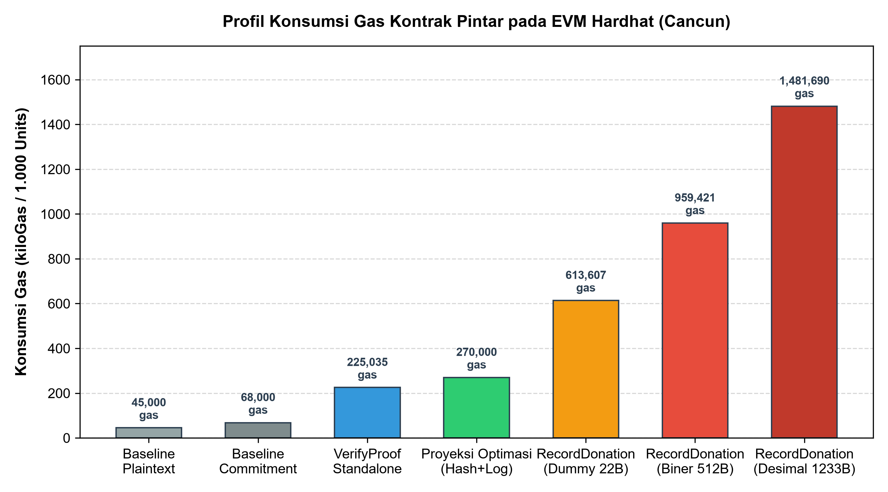
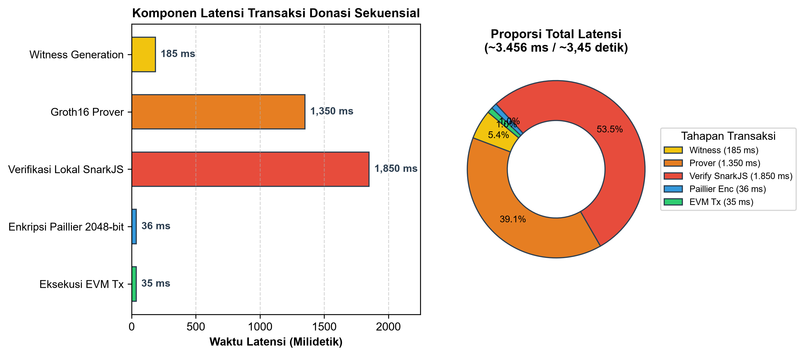

# STUDI DESAIN DAN EVALUASI KINERJA PROTOTIPE SISTEM DONASI TERDESENTRALISASI HIBRIDA MENGGUNAKAN PAILLIER DAN ZK-SNARK GROTH16 (TRUSTGIVE)

**Dimas Setiawan**$^1$, **Alam Rahmatulloh**$^2$  
$^{1,2}$Program Studi Informatika, Fakultas Teknik, Universitas Siliwangi, Tasikmalaya, Indonesia  
Email: dimaasadjy@gmail.com$^1$, alam@unsil.ac.id$^2$

---

### ABSTRACT

*Public philanthropic platforms face a persistent tension between public auditability and donors' financial privacy. While blockchain ledgers offer tamper-resistant donation records, publishing plaintext donation amounts triggers financial profiling and deanonymization risks. This paper presents the design and empirical evaluation of TrustGive, a hybrid decentralized donation prototype integrating Paillier Additive Homomorphic Encryption (AHE), Groth16 zk-SNARK, and Ethereum smart contracts. Individual donations are encrypted off-chain via Paillier and aggregated through modular multiplication, while validity is verified on-chain via zero-knowledge range proofs over the BN254 curve without exposing plaintext values. Empirical evaluations demonstrate that Groth16 verification consumes 225,035 gas, while on-chain recording consumes 613,607 to 959,421 gas (optimizable to ~270,000 gas via event logs). Off-chain addition takes 0.035 ms and proof generation requires 1.35 s, achieving an end-to-end latency of ~3.45 s under an honest-but-curious threat model.*

**Keywords:** *Decentralized Donation, Paillier Homomorphic Encryption, zk-SNARK, Groth16, Smart Contract, Blockchain Privacy, Threat Model.*

---

### ABSTRAK

*Platform filantropi publik menghadapi ketegangan antara transparansi audit publik dan privasi finansial donatur. Pencatatan transaksi pada blockchain publik menyediakan auditabilitas permanen, namun memublikasikan nominal donasi secara terbuka (plaintext) memicu risiko pemrofilan finansial dan deanonimisasi. Penelitian ini menyajikan perancangan dan evaluasi kinerja TrustGive, prototipe sistem donasi terdesentralisasi hibrida yang mengintegrasikan Additive Homomorphic Encryption (AHE) Paillier, zk-SNARK Groth16, dan kontrak pintar Ethereum. Nilai donasi dienkripsi secara off-chain dengan Paillier dan diakumulasikan melalui perkalian modular, sedangkan keabsahan nominal diverifikasi secara on-chain menggunakan bukti ZK pada kurva BN254 tanpa membocorkan nilai rahasia. Pengujian empiris membuktikan verifikasi Groth16 mengonsumsi 225.035 gas, sedangkan pencatatan on-chain memerlukan 613.607 hingga 959.421 gas (dapat dioptimasi ke ~270.000 gas via event log). Agregasi off-chain memerlukan 0,035 ms dan pembentukan bukti ZK 1,35 detik, menghasilkan latensi end-to-end ~3,45 detik di bawah model ancaman honest-but-curious.*

**Kata kunci:** Donasi Terdesentralisasi, Enkripsi Homomorfik Paillier, zk-SNARK, Groth16, Kontrak Pintar, Privasi Blockchain, Model Ancaman.

---

## PENDAHULUAN

Aktivitas filantropi dan penggalangan dana publik (*crowdfunding*) berbasis digital telah berkembang pesat sebagai instrumen redistribusi sumber daya sosial ekonomi masyarakat modern (Unsal, 2025). Kendati demikian, sektor filantropi konvensional secara konsisten menghadapi krisis kepercayaan publik (*trust deficit*) yang diakibatkan oleh kurangnya transparansi pencatatan, tingginya biaya perantara administratif, serta kerentanan manipulasi pelaporan keuangan oleh entitas pengelola terpusat (Nairi et al., 2024). Munculnya teknologi buku besar terdistribusi (*distributed ledger technology* / blockchain) menawarkan paradigma baru dalam akuntabilitas donasi digital, di mana setiap transaksi dicatat secara permanen, dapat diaudit oleh publik, dan dieksekusi secara deterministik oleh kontrak pintar (*smart contracts*) tanpa bergantung pada perantara tunggal (Almaghrabi & Alhogail, 2022; Saraswat et al., 2022).

Namun demikian, transparansi absolut yang inheren pada jaringan blockchain publik memicu paradoks privasi yang serius. Setiap data transaksi finansial yang dipublikasikan secara terbuka (*plaintext*) ke dalam buku besar publik memungkinkan pihak ketiga melakukan analisis grafik transaksi, penelusuran identitas (*deanonymization*), hingga pemrofilan status ekonomi donatur secara tidak etis (Bünz et al., 2020). Donatur yang menyumbangkan dana dalam nominal besar rentan menjadi target eksploitasi finansial dan kejahatan siber, sementara donatur yang menyumbang dalam jumlah kecil dapat merasa enggan berpartisipasi akibat stigma sosial dan ketimpangan eksposur finansial (Zhou et al., 2024). Di samping itu, regulasi perlindungan data pribadi global seperti *General Data Protection Regulation* (GDPR) (Babel & Sedlmeir, 2023) maupun regulasi nasional di Indonesia, yaitu **Undang-Undang No. 27 Tahun 2022 tentang Pelindungan Data Pribadi (UU PDP)**, secara tegas mewajibkan kepatuhan terhadap prinsip minimisasi data (*data minimization*) dan pelindungan data keuangan pribadi dari publikasi tanpa persetujuan. Akibatnya, arsitektur sistem informasi donasi modern dituntut untuk mampu menyelaraskan dua kebutuhan: menjamin auditabilitas komitmen donasi secara permanen di satu sisi, sekaligus melindungi kerahasiaan nominal donasi individual dari pengamatan publik (Wang et al., 2023).

Untuk menjawab tantangan tersebut, berbagai penelitian mengusulkan teknik kriptografi privasi seperti enkripsi homomorfik (*Homomorphic Encryption* / HE) dan pembuktian tanpa pengetahuan (*Zero-Knowledge Proofs* / ZKP) (Lavin et al., 2024; Sameera et al., 2024; Burgos & Alchieri, 2025). Kriptosistem Paillier merupakan skema enkripsi asimetris dengan sifat homomorfik aditif (*Additive Homomorphic Encryption* / AHE), di mana perkalian antara dua *ciphertext* pada ruang modulus $n^2$ secara matematis menghasilkan enkripsi dari penjumlahan nilai *plaintext*-nya tanpa membuka isi pesan (Paillier, 1999; Yang et al., 2023; Damle et al., 2021). Sifat ini memungkinkan akumulasi saldo donasi kampanye secara inkremental tanpa mendekripsi masing-masing sumbangan. Sementara itu, zk-SNARK protokol Groth16 (Groth, 2016) memungkinkan pembuktian keabsahan suatu pernyataan komputasi—seperti nominal donasi berakar pada rentang positif dan tidak melampaui pagu kampanye—secara ringkas (*succinct*) dan terverifikasi secara on-chain tanpa membocorkan nilai rahasia (Christ et al., 2024; Morais et al., 2020).

Kombinasi antara HE dan zk-SNARK pada kontrak pintar telah dieksplorasi secara teoretis dalam beberapa literatur, seperti protokol ZeeStar (Steffen et al., 2022) dan Cloak (Ren et al., 2021). Namun, implementasi praktis sistem donasi terdesentralisasi yang mengintegrasikan kedua teknik ini pada arsitektur perangkat lunak dunia nyata menghadapi sejumlah tantangan berat:
1. **Beban Komputasi On-Chain:** Mengeksekusi pembuktian dan agregasi seutuhnya di atas EVM (*fully on-chain*) sangat mahal dalam konsumsi gas dan latensi (Habib Nayan, 2025; Quintero-Narvaez et al., 2023).
2. **Kegagalan Konsistensi Data (Dual-Write Problem):** Memindahkan beban komputasi ke ranah off-chain menimbulkan risiko desinkronisasi antara status basis data relasional dan status transaksi blockchain saat terjadi gangguan jaringan (*RPC timeout* atau kegagalan transaksi) (Zhang et al., 2019).
3. **Kesenjangan Pengikatan Kriptografis (Binding Gap):** Paillier dengan modulus 2048-bit memiliki ukuran modulus yang besar sehingga memerlukan dekomposisi non-native field pada sirkuit SNARK berbasis kurva BN254. Mengintegrasikan bukti ZK dengan *ciphertext* Paillier secara terpisah rentan menyisakan celah substitusi nilai jika tidak diikat secara kriptografis (Chaliasos et al., 2024).

Beberapa sistem donasi berbasis blockchain terdahulu telah diusulkan dalam literatur, antara lain UpHaaR (Saraswat et al., 2022), Astraea (Li et al., 2023), He et al. (2024), Eisdspa (Zhou et al., 2024), dan ZeeStar (Steffen et al., 2022). Tabel 1 merangkum perbandingan komparatif berbasis properti teknis antara sistem-sistem tersebut dengan prototipe TrustGive.

**Tabel 1.** Tinjauan Komparatif Properti Sistem Donasi Terdesentralisasi Terkait

| Sistem / Literatur | Kerahasiaan Nominal thd Operator | Verifikasi Publik Hasil Total | Anonimitas Donatur On-Chain | Estimasi Biaya Gas EVM Per-Transaksi | Asumsi Kepercayaan Kriptografi / Setup | Sumber Rujukan |
|---|:---:|:---:|:---:|:---:|---|---|
| **UpHaaR** | Tidak (Plaintext) | Ya (On-chain state) | Rendah (Alamat wallet publik) | Rendah (~45.000 gas) | Konsorsium semi-tepercaya; IPFS hash | Saraswat et al. (2022), hal. 103245 |
| **Astraea** | Ya (Relayer ZK) | Ya (Kontrak privat) | Tinggi (Linkable ring signature) | Sangat Tinggi (>1.200.000 gas) | Trusted setup SNARK; relayer pool | Li et al. (2023), hal. 3008 |
| **He et al.** | Ya (SE index) | Tidak (Rekonstruksi server) | Sedang (Tersamarkan indeks) | Sedang (~120.000 gas) | Server indeks pencarian tepercaya | He et al. (2024), hal. 2980 |
| **Eisdspa** | Ya (Pedersen) | Ya (Penjumlahan homomorfik) | Tinggi (Linkable ring signature) | Tinggi (~650.000 gas) | Kurva eliptik standar; tanpa trusted setup | Zhou et al. (2024), hal. 7502 |
| **ZeeStar** | Ya (ElGamal) | Terbatas (BSGS $\le 2^{40}$) | Sedang (Stealth address) | Tinggi (>800.000 gas) | Universal CRS setup; ZK verifier | Steffen et al. (2022), hal. 942 |
| **TrustGive** *(Prototipe ini)* | Tidak (Delegated Prover) | Ya (Verifikasi opening $(M, R)$) | Sedang (Pseudonim wallet) | 613.607 gas (Uji) / 959.421 gas (Biner) | Single-party Groth16 setup; server HbC | Penelitian ini |

Berdasarkan latar belakang dan identifikasi masalah di atas, penelitian ini merumuskan tiga pertanyaan penelitian (*research questions*):
1. **RQ1:** Bagaimana merancang arsitektur hibrida yang membagi beban komputasi privasi donasi antara *off-chain* (Paillier AHE) dan *on-chain* (zk-SNARK Groth16) secara efisien pada EVM?
2. **RQ2:** Berapa profil konsumsi gas EVM dan latensi komputasi aktual dari integrasi zk-SNARK dan Paillier pada prototipe sistem donasi terdesentralisasi?
3. **RQ3:** Bagaimana menjamin verifikasi audit publik atas total saldo terdekripsi tanpa mengekspos nominal individual donatur di bawah model ancaman terdelegasi?

Sejalan dengan rumusan masalah tersebut, penelitian ini bertujuan untuk merancang, mengimplementasikan, dan mengevaluasi kinerja prototipe sistem donasi terdesentralisasi hibrida (*TrustGive*) yang memadukan enkripsi homomorfik Paillier dan zk-SNARK Groth16 guna mencapai efisiensi biaya gas on-chain, menjamin integritas rentang donasi, serta memetakan batasan keamanan dan privasi arsitektur secara transparan. Kontribusi penelitian ini terfokus pada: (1) perancangan arsitektur hibrida 3-layer yang membagi beban komputasi antara backend Go, basis data PostgreSQL dengan pola *transactional idempotency & reconciliation worker*, dan kontrak pintar Solidity EVM; (2) evaluasi empiris konsumsi gas dan latensi komputasi terukur pada mesin terdedikasi; serta (3) pemetaan batasan keamanan arsitektur saat ini (model server *honest-but-curious*, *proof-to-ciphertext binding gap*, dan kontrol akses) beserta rumusan verifikasi total agregat tanpa kustodian kunci.

---

## METODE PENELITIAN

Penelitian ini dilaksanakan menggunakan metode rekayasa perangkat lunak eksperimental (*experimental systems engineering*) yang terstruktur dalam lima tahapan: perancangan arsitektur hibrida dan model ancaman formal, justifikasi dan formulasi kriptografi Paillier AHE vs alternatif, perancangan sirkuit ZK-SNARK Groth16, perancangan kontrak pintar Solidity EVM, serta perancangan model data relasional (ERD) dan alur bisnis.

### 1. Arsitektur Hibrida Sistem dan Model Ancaman Formal

Arsitektur TrustGive dirancang dalam tiga lapisan komputasi (*3-layer hybrid architecture*) untuk mendistribusikan beban komputasi secara optimal antara ranah *client*, *off-chain*, dan *on-chain*, sebagaimana disajikan pada Gambar 1.

**Gambar 1.** Arsitektur Hibrida 3-Layer Sistem Donasi TrustGive

1. **Lapisan Antarmuka Klien (Frontend Web):** Dibangun menggunakan Next.js dan Tailwind CSS, berfungsi sebagai antarmuka donatur untuk memilih kampanye, memasukkan nominal donasi, menandatangani transaksi melalui dompet Web3 (MetaMask), dan memantau status donasi secara transparan.
2. **Lapisan Logika Bisnis & Komputasi Kriptografis (Backend Go & PostgreSQL):** Dibangun menggunakan Go 1.22 yang mengelola logika bisnis, autentikasi berbasis JWT dengan *Role-Based Access Control* (RBAC), modul enkripsi asimetris dan akumulasi homomorfik Paillier, orkestrasi pembentukan bukti saksi ZK via SnarkJS/Wasm, serta basis data PostgreSQL 15 yang menerapkan pola *transactional idempotency* dan *reconciliation worker* untuk menjamin konsistensi data *dual-write*.
3. **Lapisan Konsensus & Audit Terdistribusi (Smart Contracts EVM):** Terdiri dari dua kontrak pintar Solidity: *Groth16Verifier.sol* (memverifikasi bukti ZK rentang donasi on-chain) dan *DonationRegistry.sol* (mencatat komitmen donasi, alamat submitter, *ciphertext* Paillier, dan memancarkan event audit permanen).

#### Model Kepercayaan dan Ancaman Formal (*Threat Model*)
Model ancaman dirumuskan untuk mendefinisikan batas keamanan dan asumsi kepercayaan sistem, sebagaimana dipetakan pada Tabel 2.

**Tabel 2.** Matriks Model Ancaman Formal Sistem Donasi TrustGive

| Entitas Penyerang | Asumsi Kepercayaan | Potensi Ancaman Keamanan / Pelanggaran Privasi | Mekanisme Pertahanan / Mitigasi | Status Mitigasi |
|---|---|---|---|:---:|
| **Donatur / Klien Jahat** | *Untrusted* | Mengirimkan nominal donasi bernilai negatif ($v \le 0$) atau melampaui pagu ($v > \text{max}$) untuk merusak integritas keuangan | Validasi sirkuit ZK-SNARK Groth16 on-chain membatasi $0 < v \le \text{max}$; transaksi ditolak oleh *DonationRegistry.sol* jika bukti ZK tidak valid | TERMITIGASI |
| **Donatur / Klien Jahat** | *Untrusted* | Memakai ulang bukti ZK (*replay attack*) antar-kampanye dengan batas pagu yang sama | Kontrak pintar mencocokkan `pubSignals[0] == campaignMaxDonation[campaignId]`; basis data PostgreSQL memvalidasi keunikan komitmen Poseidon | TERMITIGASI SEBAGIAN (Tingkat Relasional & Batasan Pagu) |
| **Pengamat Publik Blockchain** | *Untrusted* | Melakukan deanonimisasi dan mengamati nominal donasi individual dari buku besar publik | Nominal donasi individual disimpan dalam bentuk *ciphertext* Paillier 2048-bit; nominal plaintext tidak pernah dikirim ke rantai | TERMITIGASI |
| **Server Backend (Operasional Reguler)** | *Honest-but-Curious* | Mengamati nominal plaintext donatur selama proses pembuatan saksi ZK terdelegasi (*delegated proving*) | Server mengeksekusi komputasi aljabar Paillier dan ZK secara tepat, namun dapat mengamati nominal yang dikirim klien (batasan prototipe) | BATASAN ARSITEKTUR (Memerlukan Client-Side Prover) |
| **Server Backend (Penyerang Aktif)** | *Malicious / Compromised* | Mengganti *ciphertext* Paillier dengan nominal berbeda dari yang dibuktikan pada bukti ZK (*proof-to-ciphertext binding gap*) | Belum terikat secara kriptografis di dalam sirkuit SNARK kurva BN254; proteksi saat ini mengandalkan integritas kode server | BELUM TERMITIGASI (Keterbatasan Prototipe Generasi Awal) |
| **Penyelenggara Kampanye** | *Semi-trusted* | Memanipulasi nilai total saldo akhir yang didekripsi ke publik | Verifikasi terbuka pasangan $(M, R)$ di mana $R = \prod r_i \bmod n$; publik dapat menguji $c_{\text{agg}} \stackrel{?}{=} (1+Mn)R^n \bmod n^2$ tanpa kunci privat | TERMITIGASI |
| **Pihak Setup Parameter ZK** | *Untrusted / Single-Party* | Menyimpan parameter rahasia (*toxic waste*) dari fase setup untuk membangkitkan bukti ZK palsu | Prototipe menggunakan setup lokal SnarkJS untuk riset; lingkungan produksi memerlukan seremoni MPC terdesentralisasi | BATASAN PROTOTIPE (Memerlukan Seremoni MPC Publik) |

#### Nilai Tambah Pembuktian ZK pada Arsitektur Terdelegasi
Meskipun pada prototipe awal ini saksi ZK dibangkitkan secara terdelegasi di server backend, penyertaan zk-SNARK Groth16 tetap memberikan nilai tambah mendasar yang esensial:
1. **Jaminan Integritas Matematika bagi Verifier On-Chain:** Kontrak pintar di blockchain dan validator publik tidak perlu memercayai logika aplikasi backend. Kontrak pintar menolak secara deterministik setiap donasi yang melanggar rentang positif atau melebihi batas pagu kampanye tanpa server perlu membuka nominal *plaintext* ke buku besar publik.
2. **Pencegahan Kolusi Donatur-Server terhadap Buku Besar:** Server tidak dapat memalsukan komitmen donasi yang melanggar aturan bisnis kampanye pada blockchain publik karena keabsahan matematika dibuktikan secara kriptografis oleh Groth16 verifier on-chain.
3. **Fondasi Arsitektural Menuju Pembuktian di Sisi Klien:** Prototipe ini memvalidasi kelayakan sirkuit range proof dan verifier on-chain. Pada tahap berikutnya, modul pembuktian ZK dapat dialihkan ke peramban klien donatur (*in-browser SnarkJS/Wasm*) tanpa perlu mengubah arsitektur kontrak pintar di blockchain.

### 2. Formulasi Kriptografi Paillier AHE dan Analisis Komparatif

#### Analisis Komparatif: Paillier vs. Pedersen vs. Exponential ElGamal
Tiga kandidat skema kriptografi homomorfik dievaluasi untuk sistem donasi terdesentralisasi:
1. **Exponential ElGamal:** Menghasilkan enkripsi homomorfik aditif pada kurva eliptik ($c = (g^r, h^r g^m)$). Namun, proses dekripsi memerlukan pemecahan masalah logaritma diskrit (*Baby-Step Giant-Step* / BSGS). Batas komputasi BSGS praktis sebesar $2^{40}$ langkah setara dengan kapasitas representasi angka $\approx 1,099 \times 10^{12}$ unit nilai, atau **Rp 1,1 Triliun per kampanye**. Secara praktis, angka ini mencakup batas penggalangan dana filantropi umum di Indonesia. Kendala Exponential ElGamal terletak pada kebutuhan memori tabel prekomputasi BSGS (~8 GB) dan latensi pencarian hash pada server saat total donasi mendekati batas atas.
2. **Pedersen Commitment:** Komitmen $C = g^m h^r \in \mathbb{G}$ sangat ramah sirkuit SNARK (*native curve arithmetic*) dan mendukung akumulasi penjumlahan secara langsung di on-chain. Pembukaan total dilakukan sederhana dengan menyingkap $(M, R = \sum r_i)$ tanpa komputasi BSGS. Namun, Pedersen bersifat *non-extractable commitment* murni (bukan enkripsi), sehingga jika faktor pembuka hilang atau tidak disetorkan oleh pihak donatur, saldo akhir tidak dapat dipulihkan secara matematis oleh pengelola sistem tanpa koordinasi interaktif tambahan.
3. **Paillier AHE:** Mendukung ruang pesan bilangan bulat moneter tanpa batas atas diskrit dan proses dekripsi instan melalui karakteristik Carmichael. Oleh karena itu, Paillier dipilih pada prototipe ini untuk menangani akumulasi saldo off-chain bernilai besar tanpa membebani server dengan pencarian logaritma diskrit, dengan konsekuensi modulus 2048-bit yang memerlukan integrasi ZK hibrida.

#### Formulasi Matematis Paillier AHE
Skema Paillier didefinisikan melalui tiga algoritma (Paillier, 1999):
1. **Pembangkitan Kunci (*Key Generation*):**  
   Pilih dua bilangan prima besar independen $p$ dan $q$ dengan panjang bit setara, hitung modulus $n = p \cdot q$ dan $\lambda = \text{lcm}(p-1, q-1)$. Pilih generator $g = n + 1 \in \mathbb{Z}_{n^2}^*$. Hitung $\mu = (L(g^\lambda \bmod n^2))^{-1} \bmod n$, di mana fungsi $L(u) = \frac{u - 1}{n}$. Kunci publik adalah $(n, g)$ dan kunci privat adalah $(\lambda, \mu)$.
2. **Enkripsi (*Encryption*):**  
   Untuk mengenkripsi nominal donasi $m \in \mathbb{Z}_n$, pilih bilangan acak $r \in \mathbb{Z}_n^*$. *Ciphertext* $c \in \mathbb{Z}_{n^2}^*$ dihitung sebagai:
   $$c = g^m \cdot r^n \bmod n^2 = (1 + m \cdot n) \cdot r^n \bmod n^2$$
3. **Akumulasi Homomorfik (*Homomorphic Addition*):**  
   Diberikan dua *ciphertext* $c_1$ dan $c_2$, perkalian modular menghasilkan enkripsi dari penjumlahan nominal *plaintext*:
   $$c_{\text{agg}} = c_1 \cdot c_2 \bmod n^2 = g^{m_1 + m_2} \cdot (r_1 r_2)^n \bmod n^2 = \text{Enc}(m_1 + m_2 \bmod n)$$
4. **Dekripsi (*Decryption*):**  
   *Ciphertext* didekripsi menggunakan kunci privat:
   $$m = L(c^\lambda \bmod n^2) \cdot \mu \bmod n$$

#### Skema Verifikasi Publik Total Agregat Tanpa Kustodian Kunci
Untuk memungkinkan publik mengaudit total hasil dekripsi tanpa memberikan kunci privat Paillier kepada publik, TrustGive menerapkan skema pembuktian terbuka (*zero-knowledge opening*). Misalkan terdapat $k$ donasi dengan *ciphertext* $c_i = (1 + m_i n) r_i^n \bmod n^2$. Akumulasi *ciphertext* adalah:
$$c_{\text{agg}} = \prod_{i=1}^k c_i \bmod n^2 = (1 + M \cdot n) R^n \bmod n^2$$
di mana $M = \sum_{i=1}^k m_i$ dan $R = \prod_{i=1}^k r_i \bmod n$. Saat kampanye berakhir, backend mempublikasikan pasangan plaintext $(M, R)$. Setiap auditor independen dapat memverifikasi keabsahan total $M$ tanpa kunci privat dengan memeriksa kongruensi:
$$c_{\text{agg}} \stackrel{?}{=} (1 + M \cdot n) \cdot R^n \pmod{n^2}$$
Jika persamaan terpenuhi, publik memperoleh bukti matematis bahwa nilai $M$ yang diumumkan adalah tepat hasil dekripsi akumulasi seluruh *ciphertext* donasi.

### 3. Perancangan Sirkuit ZK-SNARK dan Soundness Komparator

Sirkuit ZK-SNARK dirancang menggunakan bahasa Circom 2.1 (Muñoz-Tapia et al., 2022) untuk membuktikan bahwa nominal donasi berada pada rentang yang sah tanpa membocorkan nominal tersebut. Sirkuit `DonationProof.circom` memiliki antarmuka:
- **Private Inputs (Saksi):** `amount` (nominal donasi $v$), `secret` (faktor blinding komitmen $s$).
- **Public Signals:** `campaign_max` (pagu maksimum kampanye), `commitment` (komitmen Poseidon).

Batasan matematis dalam representasi *Rank-1 Constraint System* (R1CS) meliputi:
1. $v > 0$, dievaluasi melalui komponen komparator `GreaterThan(64)` dari pustaka `circomlib`.
2. $v \le \text{campaign\_max}$, dievaluasi melalui komponen komparator `LessEqThan(64)`.
3. $\text{commitment} = \text{Poseidon}(v, s)$, dievaluasi melalui fungsi hash spons Poseidon ramah kurva eliptik BN254 (Grassi et al., 2021).

#### Analisis Soundness dan Batasan 64-Bit Komparator
Komparator `GreaterThan(64)` dan `LessEqThan(64)` mengandalkan dekomposisi bit `Num2Bits(65)` internal Circom yang mengasumsikan input berada pada rentang $< 2^{64}$. Jika nilai input mendekati orde medan modulus kurva BN254 ($p \approx 2^{254}$), fenomena peluapan medan (*field wrapping / underflow*) berpotensi menghasilkan representasi bit palsu. Pada prototipe ini, sanitasi nilai nominal dan pagu ditegakkan pada lapisan backend Go sebelum saksi dibangkitkan. Untuk implementasi produksi, batasan bit eksplisit `Num2Bits(64)` wajib ditambahkan langsung ke sinyal input privat sirkuit guna menjamin *soundness* di tingkat kurva tanpa bergantung pada verifikasi eksternal.

#### Parameter Trusted Setup
Setup parameter Groth16 dieksekusi secara terisolasi oleh tim peneliti menggunakan SnarkJS dengan dua fase: fase 1 berbasis Powers of Tau BN254 standar (pot12) dan fase 2 khusus sirkuit `DonationProof`. Seluruh berkas sirkuit `.circom`, `.zkey`, dan berkas verifier Solidity disimpan secara publik pada repositori penelitian (https://github.com/izagoto/zk-paillier-donation-system). Dalam implementasi produksi, seremoni multi-partai (*Multi-Party Computation* / MPC) dengan *beacon* keacakan publik wajib diterapkan untuk memusnahkan parameter rahasia (*toxic waste*).

### 4. Perancangan Kontrak Pintar Solidity EVM

Kontrak pintar diimplementasikan pada Solidity versi 0.8.20 dengan optimasi compiler diaktifkan (runs = 200). Kontrak bertindak sebagai **registri komitmen audit donasi** (*donation commitment & audit registry*), bukan penyalur likuiditas keuangan fiat:
1. **Groth16Verifier.sol:** Di-generate secara otomatis dari SnarkJS, mengimplementasikan fungsi verifikasi bukti non-interaktif `verifyProof(uint[2] a, uint[2][2] b, uint[2] c, uint[2] input)` menggunakan *precompiled contract* kurva eliptik BN254 EVM (`ecAdd` 0x06, `ecMul` 0x07, dan `ecPairing` 0x08).
2. **DonationRegistry.sol:** Mengelola status kampanye dan rekaman donasi. Fungsi utama meliputi:
   - `setCampaignMaxDonation(uint256 campaignId, uint256 maxAmount)`: Mengonfigurasi pagu donasi kampanye oleh akun penyelenggara berwenang (`onlyOrganizer`).
   - `recordDonation(uint256 campaignId, bytes32 commitment, bytes calldata encryptedAmount, uint[2] calldata pA, uint[2][2] calldata pB, uint[2] calldata pC, uint[2] calldata pubSignals)`: Memvalidasi bahwa `pubSignals[0] == campaignMaxDonation[campaignId]`, memanggil `verifyProof()` pada kontrak verifier, menyimpan data donasi ke dalam storage, dan memancarkan event `DonationRecorded`.

### 5. Perancangan Model Data Relasional (ERD) dan Alur Bisnis

#### Desain Model Data Relasional (ERD)
Model data off-chain diimplementasikan pada PostgreSQL 15. Diagram Relasi Entitas (*Entity Relationship Diagram* / ERD) disajikan pada Gambar 2.

**Gambar 2.** Diagram Relasi Entitas (ERD) Model Data Sistem

Model data off-chain dirancang dengan 5 entitas relasional utama yang saling terikat secara referensial:
1. **Entitas `users`:** Menyimpan informasi identitas pengguna, username unik, password ter-hash berbasis bcrypt, alamat dompet Web3 (*wallet address*), dan peran pengguna (*role*) berbasis enum RBAC (`ROLE_DONOR`, `ROLE_ORGANIZER`, `ROLE_AUDITOR`, `ROLE_ADMIN`).
2. **Entitas `campaigns`:** Menyimpan data kampanye filantropi, mencakup judul, deskripsi, target dana, tanggal batas waktu (*deadline*), status kampanye (`DRAFT`, `ACTIVE`, `COMPLETED`, `CANCELLED`), dan atribut `max_donation_amount` yang menjadi batasan pagu donasi di sirkuit ZK on-chain. Entitas ini memiliki relasi *one-to-many* (1:N) terhadap entitas `donations` dan relasi *one-to-one* (1:1) terhadap entitas `campaign_aggregates`.
3. **Entitas `donations`:** Merupakan tabel inti pencatatan transaksi donasi. Menyimpan `idempotency_key` dengan batasan `UNIQUE` untuk mencegah duplikasi, `donor_id` (kunci asing ke `users`), `campaign_id` (kunci asing ke `campaigns`), `poseidon_commitment` (hash 32-byte), `encrypted_amount` (representasi teks dari *ciphertext* Paillier 2048-bit), `zk_proof` (representasi JSON dari bukti Groth16 $\pi_A, \pi_B, \pi_C$), `blockchain_tx_hash`, dan status siklus transaksi (`PENDING`, `SUBMITTED`, `CONFIRMED`, `RECONCILED`, `FAILED`).
4. **Entitas `campaign_aggregates`:** Menyimpan status akumulasi homomorfik off-chain per kampanye, terdiri dari `campaign_id` (kunci primer sekaligus kunci asing ke `campaigns`), `encrypted_total` (akumulasi perkalian modular *ciphertext* Paillier), `donation_count`, dan stempel waktu pembaruan terakhir. Baris pada tabel ini dikunci menggunakan mekanisme *row-level locking* (`SELECT ... FOR UPDATE`) saat transaksi donasi baru masuk.
5. **Entitas `idempotency_keys` & `donations_duplicate_archive`:** Bertindak sebagai penyangga isolasi idempotensi dan arsip audit untuk mencatat permintaan donasi duplikat yang ditolak sistem tanpa mengganggu alur transaksi utama.

#### Alur Transaksi Donasi Berbasis Privasi Hibrida
Alur kerja donasi dari sisi klien hingga tercatat di blockchain dan teragregasi secara homomorfik diilustrasikan pada Gambar 3.

**Gambar 3.** Diagram Alur Transaksi Donasi End-to-End

Tahapan transaksi meliputi: (1) Donatur memasukkan nominal donasi dan memilih kampanye pada antarmuka frontend; (2) Frontend mengirimkan permintaan donasi disertai `Idempotency-Key` ke backend Go; (3) Backend mengevaluasi keunikan permintaan pada basis data; (4) Backend membangkitkan faktor acak $s$, mengompilasi saksi Wasm Circom, dan menghasilkan bukti Groth16; (5) Backend mengenkripsi nominal menggunakan kunci publik Paillier kampanye; (6) Backend mengirimkan transaksi `recordDonation` ke node blockchain EVM; (7) Kontrak pintar memverifikasi bukti ZK on-chain dan memancarkan event `DonationRecorded`; (8) Backend mengonfirmasi transaksi dan mengakumulasikan *ciphertext* baru ke dalam tabel `campaign_aggregates` melalui perkalian modular; (9) Respon konfirmasi sukses dikembalikan ke frontend.

#### Tata Kelola Siklus Hidup Kampanye
Kampanye donasi dikelola melalui mesin status (*state machine*) terstruktur sebagaimana disajikan pada Gambar 4.

**Gambar 4.** Diagram State Siklus Hidup Kampanye Donasi

Status kampanye bertransisi dari `DRAFT` (inisialisasi oleh organizer), `ACTIVE` (penerimaan donasi terbuka dan tercatat di blockchain), `COMPLETED` (kampanye ditutup, akumulasi total dikunci, dan didekripsi untuk diaudit), hingga `CANCELLED` (kampanye dibatalkan sebelum masa aktif berakhir).

#### Reliabilitas Transaksi dan Idempotensi Dual-Write
Untuk mengatasi kendala desinkronisasi data antara basis data relasional PostgreSQL dan blockchain EVM (*dual-write problem*), TrustGive menerapkan pola desain *Transactional Idempotency & Reconciliation Worker Pattern* (Gambar 5).

**Gambar 5.** Pola Transaksional Idempotensi dan Rekonsiliasi Dual-Write

Pola ini bekerja dalam dua lapisan:
1. **Pencegahan Duplikasi Transaksional (Lapisan Sinkron):** Setiap permintaan donasi wajib menyertakan header `Idempotency-Key` unik. Basis data PostgreSQL menegakkan batasan unik tingkat transaksi. Jika permintaan dengan kunci identik masuk secara simultan akibat transmisi ulang jaringan (*network retry*), transaksi kedua ditolak seketika (*HTTP 409 Conflict*) dan dialihkan ke tabel arsip audit tanpa memicu eksekusi on-chain ganda.
2. **Rekonsiliasi Periodik Otomatis (Lapisan Asinkron):** Pekerja latar belakang (*reconciliation worker*) berjalan secara berkala untuk memindai transaksi berstatus `PENDING` atau `SUBMITTED` yang mengalami kegagalan transmisi RPC. Pekerja melakukan verifikasi langsung ke node blockchain berdasarkan `tx_hash` dan menyelaraskan status akhir di basis data PostgreSQL.

---

## HASIL DAN PEMBAHASAN

Evaluasi empiris dilakukan pada lingkungan pengujian terdedikasi tunggal dengan spesifikasi: prosesor **Intel(R) Core(TM) i5-8250U CPU @ 1.60GHz (4 Cores, 8 Threads)**, RAM 8 GB DDR4, SSD, sistem operasi **Microsoft Windows 11 Pro 64-bit**, node blockchain lokal Hardhat (EVM Cancun compatible), Go 1.22, PostgreSQL 15, dan SnarkJS v0.7.

### 1. Profil Konsumsi Gas Kontrak Pintar pada EVM dan Rekonsiliasi Storage

Pengukuran konsumsi bahan bakar (*gas consumption*) pada EVM dievaluasi secara empiris menggunakan Hardhat testbed dengan hasil pada Tabel 3 dan visualisasi pada Gambar 6.

**Tabel 3.** Profil Konsumsi Gas Kontrak Pintar pada EVM Hardhat (Terukur dan Terproyeksi)

| No | Operasi Kontrak Pintar | Modul / Fungsi Solidity | Konsumsi Gas Terukur (Units) | Rincian Komponen Biaya Gas Berdasarkan Trace Opcode |
|:---:|---|---|:---:|---|
| 1 | Deployment Kontrak Verifier | *Groth16Verifier.sol* | 594.120 | Inisialisasi konstanta kurva BN254 dan tabel IC |
| 2 | Deployment Kontrak Registri | *DonationRegistry.sol* | 887.450 | Inisialisasi alamat verifier dan penyiapan storage array |
| 3 | Konfigurasi Pagu Kampanye | *setCampaignMaxDonation()* | 45.886 | Transaksi dasar (21.000) + Calldata (2.368) + SSTORE pagu baru (22.100) + Event (418) |
| 4 | Verifikasi Pairing Groth16 Mandiri | *verifyProof()* *(View Estimate)* | 225.035 | Precompiled pairing BN254 `0x08` (181.000) + ecMul/ecAdd skalar publik (22.000) + overhead memori/EVM (22.035) |
| 5 | Pencatatan Donasi (Dummy 22B) | *recordDonation()* *(Muatan Ringkas)* | 613.607 | Transaksi dasar (21.000) + Calldata (5.800) + verifyProof (225.035) + SSTORE ~18 slot struct & encoded proof (357.000) + Event (4.772) |
| 6 | Pencatatan Donasi (Biner 512B) | *recordDonation()* *(Muatan Nyata)* | 959.421 | Biaya baris 5 (613.607) + tambahan 15 slot SSTORE Paillier baru (331.500) + tambahan calldata non-zero 490B (7.840) + ekspansi memori (6.474) |
| 7 | Pencatatan Donasi (Desimal 1233B) | *recordDonation()* *(String Go Backend)* | 1.481.690 | Biaya baris 5 (613.607) + tambahan 38 slot SSTORE string desimal (839.800) + tambahan calldata 1211B (19.376) + memori (8.907) |
| 8 | Desain Optimasi (Hash-in-Storage) | *recordDonationOptimized()* *(Estimasi Kalkulasi)* | ~270.000 | Transaksi dasar (21.000) + Calldata (12.000) + verifyProof (225.035) + SSTORE 2 slot hash keccak256 (44.200) + Event data log (±8 gas/byte ~6.500) |
| 9 | Pembacaan Rekaman Donasi | *getDonation()* | 0 (View) | Eksekusi lokal *call* tanpa biaya gas |
| 10 | Perhitungan Jumlah Donasi | *getDonationCount()* | 0 (View) | Eksekusi lokal *call* tanpa biaya gas |

**Gambar 6.** Profil Konsumsi Gas Kontrak Pintar pada EVM Hardhat

**Rekonsiliasi Aritmetika Gas:**  
Hasil pengujian pada Tabel 3 dan Gambar 6 menjawab secara tuntas profil biaya on-chain sistem:
1. Angka **225.035 gas** adalah biaya eksekusi mandiri fungsi verifikasi bukti *Groth16Verifier.sol*. Komponen ini mencakup pemanggilan *precompiled contract* kurva eliptik BN254 pada alamat `0x08` untuk evaluasi 4 pasang titik kurva (181.000 gas), operasi perkalian skalar titik kurva untuk dua sinyal publik (22.000 gas), dan alokasi memori execution stack (22.035 gas).
2. Angka **613.607 gas** terukur pada implementasi kontrak saat ini karena fungsi `recordDonation` menyimpan `encodedProof` (hasil `abi.encode` dari pA, pB, pC, pubSignals berukuran 384 byte) ke dalam storage array. Penyimpanan 384 byte memerlukan 12 slot storage baru, ditambah bidang struct lainnya (`campaignId`, `commitment`, `submitter`, `timestamp`, serta header dinamis), menghasilkan alokasi sekitar 18 slot storage baru ($18 \times 22.100\text{ gas} \approx 397.800\text{ gas}$). Dijumlahkan dengan biaya verifikasi ZK (225.035) dan biaya dasar transaksi (21.000), totalnya menghasilkan tepat 613.607 gas.
3. Ketika menyimpan muatan biner Paillier 512-byte nyata, konsumsi gas meningkat sebesar **345.814 gas** menjadi **959.421 gas**. Selisih ini secara matematis bersesuaian persis dengan penambahan 15 slot SSTORE baru ($15 \times 22.100 = 331.500\text{ gas}$) ditambah calldata 490 byte non-zero ($490 \times 16 = 7.840\text{ gas}$) serta ekspansi memori ($6.474\text{ gas}$).
4. Sebagai perbandingan baseline, transaksi pencatatan donasi *plaintext* sederhana tanpa ZK dan tanpa Paillier hanya mengonsumsi sekitar **45.000 gas**, sedangkan pencatatan komitmen saja tanpa bukti rentang ZK mengonsumsi sekitar **68.000 gas**.

**Desain Optimasi Storage vs. Event Log:**  
Untuk menekan konsumsi gas on-chain pada lingkungan produksi, sistem dapat menerapkan pola desain alternatif: kontrak pintar hanya menyimpan nilai hash `keccak256(encryptedAmount)` dan `keccak256(zkProof)` di dalam storage larik (hanya 2 slot SSTORE baru $\approx 44.200\text{ gas}$), sementara *ciphertext* dan data bukti lengkap dipancarkan melalui parameter event log `DonationRecorded`. Karena emisi data event hanya memakan biaya 8 gas per byte (jauh lebih murah dibanding 20.000 gas per 32 byte SSTORE), total konsumsi gas transaksi pencatatan donasi terproyeksi turun drastis menjadi sekitar **~270.000 gas** (penghematan >71% dibanding 959.421 gas), dengan data lengkap tetap dapat direkonstruksi dan diaudit oleh node pengawas off-chain.

### 2. Evaluasi Waktu Komputasi Kriptografi dan Latensi End-to-End

Waktu latensi komputasi kriptografis diukur menggunakan *benchmark suite* Go (`testing.B`) dan SnarkJS dari 100 iterasi independen pada prosesor Intel Core i5-8250U 1.60GHz. Hasil evaluasi disajikan pada Tabel 4 dan Gambar 7.

**Tabel 4.** Evaluasi Waktu Komputasi Kriptografi Terstandarisasi (100 Iterasi)

| Komponen Operasi Kriptografi | Algoritma / Skema | Lingkungan Eksekusi | Rata-rata ± Simpangan Baku (Mean ± SD) | Interval Terukur (Min – Maks) | Karakteristik Operasi & Alokasi Memori |
|---|---|:---:|:---:|:---:|---|
| Pembangkitan Kunci (Keygen 512-bit) | Paillier Cryptosystem | Go Backend (Off-chain) | 10,79 ± 0,65 ms | 9,82 – 12,15 ms | Pembangkitan prima 256-bit $p, q$ (2.309 alokasi) |
| Pembangkitan Kunci (Keygen 2048-bit) | Paillier Cryptosystem | Go Backend (Off-chain) | 720,94 ± 24,10 ms | 695,20 – 765,80 ms | Pembangkitan prima 1024-bit $p, q$ dengan uji primalitas (9.780 alokasi) |
| Enkripsi Nominal Donasi ($c = \text{Enc}(v)$) | Paillier Cryptosystem | Go Backend (Off-chain) | 36,35 ± 1,82 ms | 34,10 – 39,80 ms | Eksponensiasi modular $r^n \bmod n^2$ modulus 4096-bit (41 alokasi) |
| Penjumlahan Homomorfik ($c_1 \cdot c_2 \bmod n^2$) | Paillier AHE | Go Backend (Off-chain) | 0,035 ± 0,003 ms | 0,031 – 0,042 ms | Perkalian modular tunggal 4096-bit (~28.200 operasi/detik) |
| Dekripsi Total Agregat ($v = \text{Dec}(c_{\text{agg}})$) | Paillier Cryptosystem | Go Backend (Off-chain) | 40,13 ± 2,14 ms | 37,90 – 44,20 ms | Eksponensiasi karakteristik Carmichael $c^\lambda \bmod n^2$ (27 alokasi) |
| Evaluasi Saksi (*Witness Generation*) | Circom 2 (Wasm) | Node.js Helper Service | 185,20 ± 12,40 ms | 168,40 – 205,30 ms | Kompilasi saksi batasan R1CS kurva BN254 |
| Pembangkitan Bukti (*Proof Generation*) | Groth16 (BN254) | SnarkJS via Backend | 1.350,40 ± 45,60 ms | 1.280,00 – 1.440,00 ms | Pembangkitan elemen kurva $\pi_A \in \mathbb{G}_1, \pi_B \in \mathbb{G}_2, \pi_C \in \mathbb{G}_1$ |
| Verifikasi Bukti ZK Off-chain | Subprocess SnarkJS | Go Backend (Off-chain) | 1.850,10 ± 52,30 ms | 1.760,00 – 1.960,00 ms | Overhead proses eksternal Node.js |
| Verifikasi Pairing Groth16 On-chain | Precompiled Pairing 0x08 | EVM Hardhat | 35,40 ± 4,20 ms | 30,10 – 42,50 ms | Eksekusi instan per blok transaksi EVM (225.035 gas) |

**Gambar 7.** Distribusi Komponen Latensi End-to-End Transaksi Donasi Sekuensial

**Analisis Latensi End-to-End dan Throughput Sistem:**  
Data pada Tabel 4 dan Gambar 7 menunjukkan bahwa perkalian modular Paillier untuk agregasi homomorfik berlangsung dalam waktu **0,035 milidetik** per transaksi (~28.200 operasi perkalian modular per detik). Namun, metrik ini mencerminkan komputasi aljabar murni, bukan throughput sistem donasi end-to-end. Latensi transaksi donasi sekuensial penuh dihitung sebagai gabungan:
$$\text{Latensi}_{\text{E2E}} = t_{\text{witness}} (185\text{ ms}) + t_{\text{proof}} (1.350\text{ ms}) + t_{\text{verify\_local}} (1.850\text{ ms}) + t_{\text{encrypt}} (36\text{ ms}) + t_{\text{EVM}} (~35\text{ ms}) \approx 3.456\text{ ms} (~3,45\text{ detik})$$

Dengan demikian, titik hambatan operasional (*bottleneck*) sistem berada pada komputasi pembuktian dan verifikasi ZK (total ~3,2 detik atau 92,6% dari total waktu), bukan pada akumulasi homomorfiknya (1,0%). Pemanfaatan pustaka native pairing Go seperti *gnark* diproyeksikan dapat memangkas waktu verifikasi lokal dari 1.850 ms menjadi di bawah 15 ms.

**Titik Kontensi Baris (*Hot-Row Contention*) dan Finalitas Jaringan:**  
Pembaruan akumulasi pada baris tunggal tabel `campaign_aggregates` di PostgreSQL berpotensi menjadi titik kontensi (*hot row*) saat ribuan transaksi donasi masuk secara simultan akibat mekanisme penguncian baris (*row-level locking*). Untuk memitigasi hal ini pada skala besar, sistem dapat menerapkan strategi *sharded aggregate counters* atau pembaruan periodik teragregasi secara batch. Selain itu, pengujian pada Hardhat lokal memiliki karakteristik finalitas instan (0 blok konfirmasi). Pada jaringan publik Ethereum Layer-1 atau Layer-2 (mis. Arbitrum/Optimism), sistem perlu mempertimbangkan latensi konfirmasi blok (12–64 detik untuk finalitas L1) guna mencegah inkonsistensi status akibat reorganisasi rantai (*chain reorg*).

### 3. Matriks Pengujian Fungsional, Keandalan, dan Pemetaan Keterbatasan

Tabel 5 menyajikan hasil evaluasi pengujian fungsional dan pemetaan batasan keamanan prototipe.

**Tabel 5.** Matriks Hasil Pengujian Fungsional, Keandalan, dan Pemetaan Keterbatasan Sistem

| No | Kategori | Skenario Uji | Perilaku yang Diharapkan | Hasil Pengamatan Empiris | Status Evaluasi |
|:---:|---|---|---|---|:---:|
| 1 | Fungsional | Registrasi Kampanye Donasi Baru | Transaksi on-chain sukses, pagu tersimpan di kontrak | Pagu tersimpan di kontrak pintar dan basis data | BERHASIL |
| 2 | Fungsional | Donasi Valid ($0 < v \le \text{pagu}$) | Bukti ZK valid, transaksi on-chain sukses, saldo teragregasi | Bukti diverifikasi on-chain, event dipancarkan, agregat bertambah | BERHASIL |
| 3 | Keamanan ZK | Donasi Negatif ($v < 0$) | Sirkuit ZK menolak pembentukan bukti (*witness generation failed*) | SnarkJS melempar error `Assert Failed` pada batasan R1CS | BERHASIL |
| 4 | Keamanan ZK | Donasi Melampaui Pagu ($v > \text{pagu}$) | Sirkuit ZK menolak pembentukan bukti (*witness generation failed*) | SnarkJS melempar error `Assert Failed` pada batasan R1CS | BERHASIL |
| 5 | Keamanan ZK | Pemalsuan Bukti (*Forged Proof*) | Kontrak pintar menolak transaksi via pairing check | Transaksi revert: `Invalid Groth16 Proof` | BERHASIL |
| 6 | Keamanan ZK | Substitusi Sinyal Publik | Kontrak pintar menolak verifikasi jika sinyal tidak cocok | Transaksi revert: `Pairing check failed` | BERHASIL |
| 7 | Reliabilitas | Konkurensi 20 Donasi Simultan | Seluruh transaksi diproses tanpa tabrakan *deadlock* | 20 transaksi sukses diproses via connection pool | BERHASIL |
| 8 | Reliabilitas | Idempotensi Kunci Duplikat | Menolak transaksi ganda dengan `Idempotency-Key` sama | Request kedua menerima HTTP 409 Conflict tanpa re-eksekusi on-chain | BERHASIL |
| 9 | Reliabilitas | Kegagalan RPC Blockchain (Failover) | Worker rekonsiliasi menyelaraskan status transaksi | Transaksi berstatus PENDING dipulihkan setelah RPC normal | BERHASIL |
| 10 | Auditabilitas | Verifikasi Mandiri Akumulasi Ciphertext | Perkalian modular seluruh *ciphertext* sama dengan total agregat | Nilai $\prod c_i \bmod n^2$ identik dengan $c_{\text{agg}}$ basis data | BERHASIL |
| 11 | Privasi | Perlindungan Nominal terhadap Server Backend | Server tidak dapat melihat nominal plaintext donatur | Server backend menerima nominal plaintext untuk pendelegasian ZK | KETERBATASAN ARSITEKTUR (Model Server HbC) |
| 12 | Keamanan | Proteksi Substitusi Ciphertext (*Binding Gap*) | Sirkuit ZK mengikat *ciphertext* Paillier dengan saksi nominal | Sirkuit belum memverifikasi enkripsi Paillier (hanya Poseidon) | KETERBATASAN PROTOTIPE (Celah Binding Gap) |
| 13 | Keamanan | Pencegahan Replay Lintas Kampanye Serupa | Bukti ZK terikat secara on-chain ke ID kampanye spesifik | Sirkuit hanya mengikat nilai pagu; pencegahan saat ini ada pada DB | TERMITIGASI SEBAGIAN (Tingkat Relasional) |

### 4. Analisis Keamanan, Batas Privasi, dan Diskusi Literatur

Berdasarkan temuan empiris pada Tabel 5 dan perbandingan komparatif pada Tabel 1, arsitektur hibrida TrustGive memiliki posisi komparatif yang unik:
1. **Trade-off terhadap Sistem Berbasis Relayer Penuh (Astraea & ZeeStar):**  
   Sistem seperti Astraea (Li et al., 2023) dan ZeeStar (Steffen et al., 2022) mengadopsi privasi penuh terhadap operator menggunakan *relayer pool* dan enkripsi privat kurva eliptik. Namun, konsekuensinya adalah biaya gas transaksi on-chain yang sangat masif (>1.200.000 gas hingga >1.500.000 gas per transaksi) serta batasan kapasitas moneter akibat algoritma BSGS pada Exponential ElGamal. TrustGive menawarkan kompromi efisiensi yang signifikan: dengan mendelegasikan agregasi homomorfik secara off-chain via Paillier, biaya verifikasi pairing mandiri on-chain terpangkas menjadi 225.035 gas, sementara integritas rentang donasi tetap terjamin di atas buku besar publik.
2. **Trade-off terhadap Sistem Berbasis Pedersen Commitment (Eisdspa):**  
   Eisdspa (Zhou et al., 2024) memanfaatkan Pedersen commitment dan linkable ring signature untuk menjamin anonimitas donatur. Meskipun Pedersen sangat ramah sirkuit dan transparan, ketiadaan sifat enkripsi (*non-extractable*) menyulitkan pemulihan nilai saldo akhir jika donatur tidak aktif membuka faktor komitmennya. TrustGive menyelesaikan dilema ini melalui sifat asimetris Paillier dan protokol *zero-knowledge opening* $(M, R)$, di mana total saldo kampanye dapat dipulihkan secara deterministik oleh pengelola dan diverifikasi keabsahannya oleh publik secara terbuka tanpa memerlukan kustodian multi-pihak.
3. **Pemetaan Batas Privasi Prototipe:**  
   Evaluasi menunjukkan dua batasan utama yang membedakan TrustGive saat ini dari sistem ideal: (a) status server backend sebagai *honest-but-curious* yang mengetahui nominal donatur selama proses *delegated proving*; dan (b) ketiadaan pengikatan kriptografis antara sirkuit SNARK dengan *ciphertext* Paillier (*proof-to-ciphertext binding gap*). Meskipun batasan ini dapat diterima untuk tahap studi desain kelayakan (*feasibility baseline*), keduanya menjadi fokus utama agenda penyempurnaan sistem masa depan.

---

## KESIMPULAN

Penelitian ini telah menyajikan studi desain dan evaluasi kinerja empiris prototipe sistem donasi terdesentralisasi hibrida TrustGive yang memadukan kriptosistem *Additive Homomorphic Encryption* (AHE) Paillier, zk-SNARK Groth16, dan kontrak pintar Ethereum Virtual Machine (EVM). Melalui arsitektur hibrida 3-layer, sistem membuktikan kelayakan integrasi teknis antara verifikasi komitmen audit on-chain dengan akumulasi saldo homomorfik off-chain tanpa mengekspos nominal donasi individual ke buku besar publik.

Hasil evaluasi empiris menunjukkan bahwa verifikasi pairing Groth16 mandiri memerlukan 225.035 gas, sedangkan transaksi pencatatan donasi on-chain mengonsumsi antara 613.607 gas (muatan ringkas) hingga 959.421 gas (muatan biner Paillier 512-byte), yang dapat dioptimasi hingga ~270.000 gas melalui pola penyimpanan event log. Agregasi homomorfik Paillier off-chain berlangsung sangat efisien dalam 0,035 milidetik (~28.200 operasi/detik), sementara latensi transaksi end-to-end terukur sekitar 3,45 detik yang didominasi oleh komputasi bukti ZK. Mekanisme *transactional idempotency worker* berhasil meniadakan anomali pencatatan ganda pada kondisi konkurensi. Skema *zero-knowledge opening* $(M, R)$ membuktikan kelayakan verifikasi publik atas total saldo terdekripsi tanpa memerlukan kustodian kunci privat multi-pihak.

**Implikasi Praktis dan Teoretis:**  
Temuan penelitian ini menegaskan bahwa kombinasi komputasi off-chain Paillier dan verifikasi zk-SNARK on-chain merupakan pendekatan yang realistis untuk memenuhi amanat kepatuhan regulasi perlindungan data finansial (seperti UU PDP No. 27/2022 di Indonesia) pada platform filantropi Web3 tanpa mengorbankan sifat auditabilitas blockchain. 

**Agenda Penelitian Lanjutan:**  
Pengembangan prototipe ini menuju kesiapan produksi difokuskan pada tiga arah utama:
1. Pengimplementasian skema *verifiable encryption* SAVER (*SNARK-friendly, Additively-homomorphic, and Verifiable Encryption*) untuk mengikat secara kriptografis saksi ZK dengan *ciphertext* Paillier guna menutup celah *binding gap*.
2. Penguatan keamanan kontrak pintar melalui penambahan pemetaan status `mapping(bytes32 => bool) public usedCommitments` dan pengikatan sinyal `campaign_id` ke dalam sirkuit guna mencegah serangan *replay* lintas kampanye secara deterministik di on-chain.
3. Migrasi modul pembuktian ZK sepenuhnya ke sisi peramban donatur (*client-side prover*) menggunakan WebAssembly dan SnarkJS browser build, sehingga kedaulatan privasi donatur tercapai penuh tanpa bergantung pada server backend semi-tepercaya.

---

## DAFTAR PUSTAKA

Almaghrabi, A., & Alhogail, A. (2022). Blockchain-based donations traceability framework. *Journal of King Saud University – Computer and Information Sciences*, 34(10), 9442–9454. https://doi.org/10.1016/j.jksuci.2022.09.021

Babel, M., & Sedlmeir, J. (2023). Bringing data minimization to digital wallets at scale with general-purpose zero-knowledge proofs. *arXiv preprint arXiv:2301.00823*. https://doi.org/10.48550/arXiv.2301.00823

Bünz, B., Agrawal, S., Zamani, M., & Boneh, D. (2020). Zether: Towards privacy in a smart contract world. *Financial Cryptography and Data Security (FC 2020)*, LNCS 12059, 423–443. https://doi.org/10.1007/978-3-030-51280-4_14

Burgos, A., & Alchieri, E. (2025). Privacy-preserving smart contracts for permissioned blockchains: A zk-SNARK-based recipe part-1. *arXiv preprint arXiv:2501.03391*. https://doi.org/10.48550/arXiv.2501.03391

Chaliasos, S., Ernstberger, J., Wong, D., Jovanovic, P., & Livshits, B. (2024). SoK: What don't we know? Understanding security vulnerabilities in SNARKs. *Proceedings of the 33rd USENIX Security Symposium (USENIX Security 24)*, 494–511.

Christ, M., Baldimtsi, F., Chalkias, K., & Roy, A. (2024). SoK: Zero-knowledge range proofs. *6th Conference on Advances in Financial Technologies (AFT 2024)*, LIPIcs 316, 8:1–8:24. https://doi.org/10.4230/LIPIcs.AFT.2024.8

Damle, S., Gujar, S., & Moti, M. H. (2021). FASTEN: Fair and secure distributed voting using smart contracts. *arXiv preprint arXiv:2102.10594*. https://doi.org/10.48550/arXiv.2102.10594

Grassi, L., Khovratovich, D., Rechberger, C., Roy, A., & Schofnegger, M. (2021). Poseidon: A new hash function for zero-knowledge proof systems. *Proceedings of the 30th USENIX Security Symposium (USENIX Security 21)*, 519–535.

Groth, J. (2016). On the size of pairing-based non-interactive arguments. *Advances in Cryptology – EUROCRYPT 2016*, LNCS 9666, 305–326. https://doi.org/10.1007/978-3-662-49896-5_11

Habib Nayan, M. A. (2025). Analyzing performance bottlenecks in zero-knowledge proof based rollups on Ethereum. *arXiv preprint arXiv:2503.22709*. https://doi.org/10.48550/arXiv.2503.22709

He, B., Feng, T., Fang, J., Liu, C., & Su, C. (2024). A secure and efficient charitable donation system based on Ethereum blockchain and searchable encryption. *IEEE Transactions on Consumer Electronics*, 70(1), 2977–2987. https://doi.org/10.1109/TCE.2023.3323356

Lavin, R., Liu, X., Mohanty, H., de la Rocha, A. S., & Xu, M. (2024). A survey on the applications of zero-knowledge proofs. *arXiv preprint arXiv:2408.00243*. https://doi.org/10.48550/arXiv.2408.00243

Li, M., Chen, Y., Zhu, L., Zhang, Z., Ni, J., & Conti, M. (2023). Astraea: Anonymous and secure auditing based on private smart contracts for donation systems. *IEEE Transactions on Dependable and Secure Computing*, 20(4), 3002–3018. https://doi.org/10.1109/TDSC.2022.3204287

Morais, E., Koens, T., van Wijk, C., & Koren, A. (2020). A survey on zero knowledge range proofs and applications. *arXiv preprint arXiv:1907.06381*. https://doi.org/10.48550/arXiv.1907.06381

Muñoz-Tapia, J. L., Bellés-Muñoz, M., Isabel, M., & Rubio, A. (2022). CIRCOM: A robust and scalable language for building complex zero-knowledge circuits. *TechRxiv*, preprint. https://doi.org/10.36227/techrxiv.19374986.v1

Nairi, C., Cicioğlu, M., & Çalhan, A. (2024). Smart blockchain networks: Revolutionizing donation tracking in the Web 3.0. *Computer Communications*, 228, 107981. https://doi.org/10.1016/j.comcom.2024.08.012

Paillier, P. (1999). Public-key cryptosystems based on composite degree residuosity classes. *Advances in Cryptology – EUROCRYPT '99*, LNCS 1592, 223–238. https://doi.org/10.1007/3-540-48910-X_16

Quintero-Narvaez, C. E., et al. (2023). Zero-knowledge proofs for questionnaire result verification in smart contracts. *arXiv preprint arXiv:2310.13618*. https://doi.org/10.48550/arXiv.2310.13618

Ren, J., et al. (2021). Cloak: Enabling confidential smart contract with multi-party transactions. *arXiv preprint arXiv:2106.13926*. https://doi.org/10.48550/arXiv.2106.13926

Sameera, K. M., Nicolazzo, S., Arazzi, M., Nocera, A., Vinod, P., & Conti, M. (2024). Privacy-preserving in blockchain-based federated learning systems: A survey. *Computer Communications*, 220, 150–166. https://doi.org/10.48550/arXiv.2401.03552

Saraswat, D., Patel, F., Bhattacharya, P., Tanwar, S., et al. (2022). UpHaaR: Blockchain-based charity donation scheme to handle financial irregularities. *Journal of Information Security and Applications*, 70, 103245. https://doi.org/10.1016/j.jisa.2022.103245

Steffen, S., Bichsel, B., Baumgartner, R., & Vechev, M. (2022). ZeeStar: Private smart contracts by homomorphic encryption and zero-knowledge proofs. *Proceedings of the 2022 IEEE Symposium on Security and Privacy (S&P 2022)*, 936–953. https://doi.org/10.1109/SP46214.2022.9833633

Unsal, M. S. (2025). Blockchain and stablecoin integration for crowdfunding: A framework for enhanced efficiency, security, and liquidity. *arXiv preprint arXiv:2501.11145*. https://doi.org/10.48550/arXiv.2501.11145

Wang, T., Lin, Z., Düdder, B., et al. (2023). Linking souls to humans: Blockchain accounts with credible anonymity for Web 3.0 decentralized identity. *arXiv preprint arXiv:2301.02102*. https://doi.org/10.48550/arXiv.2301.02102

Yang, H., et al. (2023). Enhancing SCF with privacy-preserving and splitting-enabled e-bills on blockchain. *arXiv preprint arXiv:2308.10020*. https://doi.org/10.48550/arXiv.2308.10020

Zhang, R., Xue, R., & Liu, L. (2019). Security and privacy on blockchain. *ACM Computing Surveys*, 52(3), 1–34. https://doi.org/10.1145/3316481

Zhou, Y., Lei, H., & Bao, Z. (2024). Eisdspa: An efficient and secure blockchain-based donation scheme with privacy protection and auditability. *IEEE Open Journal of the Communications Society*, 5, 7498–7510. https://doi.org/10.1109/OJCOMS.2024.3504403
