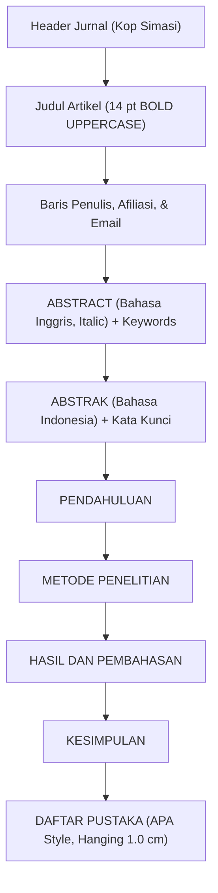

# Panduan & Aturan Format Template Jurnal SIMASI (Rules Template)

Dokumen ini merupakan panduan teknis dan acuan baku (*rules*) format penulisan artikel ilmiah berdasarkan analisis forensik berkas **`TEMPLATE SIMASI CONTOH.docx`** (*Jurnal Simasi : Jurnal Ilmiah Sistem Informasi*, LPPM Universitas Bina Bangsa, p-ISSN: 2798-835X, e-ISSN: 2798-8341).

---

## 1. Pengaturan Halaman & Tata Letak (*Page Setup & Margins*)

| Parameter | Spesifikasi Standar Template | Catatan Implementasi |
|---|---|---|
| **Ukuran Kertas (*Paper Size*)** | **Letter** ($21{,}59\text{ cm} \times 27{,}94\text{ cm}$ / $8{,}5'' \times 11''$) | Bisa disesuaikan ke **A4** ($21{,}0\text{ cm} \times 29{,}7\text{ cm}$) jika diminta prodi |
| **Orientasi (*Orientation*)** | **Portrait** | Berlaku seragam untuk seluruh halaman |
| **Jumlah Kolom (*Columns*)** | **1 Kolom (*Single Column*)** | Dari awal judul, abstrak, isi, hingga daftar pustaka |
| **Margin Atas (*Top*)** | **$2{,}54\text{ cm}$** ($1{,}0\text{ inci}$) | Sesuai batas cetak standar |
| **Margin Bawah (*Bottom*)** | **$2{,}54\text{ cm}$** ($1{,}0\text{ inci}$) | Sesuai batas cetak standar |
| **Margin Kiri (*Left*)** | **$2{,}54\text{ cm}$** ($1{,}0\text{ inci}$) | Sesuai batas cetak standar |
| **Margin Kanan (*Right*)** | **$2{,}54\text{ cm}$** ($1{,}0\text{ inci}$) | Sesuai batas cetak standar |
| **Gutter** | **$0\text{ cm}$** | Tanpa jilid lipat tengah |
| **Header dari Tepi Atas** | **$1{,}27\text{ cm}$** ($0{,}5\text{ inci}$ / $720\text{ twips}$) | Posisi kop jurnal & running header |
| **Footer dari Tepi Bawah** | **$1{,}27\text{ cm}$** ($0{,}5\text{ inci}$ / $720\text{ twips}$) | Posisi nomor halaman |

---

## 2. Tabel Spesifikasi Tipografi, Spasi, & Indentasi

Seluruh dokumen menggunakan font standar utama **Times New Roman** (kecuali banner kop atas).

| Elemen Dokumen | Font Family | Ukuran (*Size*) | Format (*Style*) | Perataan (*Alignment*) | Spasi Baris (*Line Spacing*) | Spasi Paragraf (*Before / After*) | Indentasi (*Indentation*) |
|---|---|---|---|---|---|---|---|
| **Nama Jurnal (Kop)** | Adobe Garamond Pro / TNR | **$18\text{ pt}$** | **BOLD**, UPPERCASE | Center | $1{,}0\text{ line}$ | Before: $0\text{ pt}$, After: $0\text{ pt}$ | $0\text{ cm}$ |
| **ISSN (Kop)** | Times New Roman | **$7\text{ pt}$** | *Italic* (Miring) | Center | $1{,}0\text{ line}$ | Before: $0\text{ pt}$, After: $0\text{ pt}$ | $0\text{ cm}$ |
| **URL Web Jurnal (Kop)** | Arial / Times New Roman | **$9\text{–}10\text{ pt}$** | Regular (Tegak) | Center | $1{,}0\text{ line}$ | Before: $0\text{ pt}$, After: $0\text{ pt}$ | $0\text{ cm}$ |
| **Judul Artikel (*Title*)** | Times New Roman | **$14\text{ pt}$** | **BOLD**, UPPERCASE | **Center** | **$1{,}15\text{ line}$** | Before: $0\text{ pt}$, After: $0\text{ pt}$ | $0\text{ cm}$ |
| **Nama Penulis (*Authors*)** | Times New Roman | **$10\text{ pt}$** | **BOLD**, Superskrip ($^1, ^2, ^3$) | **Center** | **$1{,}15\text{ line}$** | Before: $0\text{ pt}$, After: $0\text{ pt}$ | $0\text{ cm}$, Tanpa gelar |
| **Afiliasi & Email Penulis** | Times New Roman | **$10\text{ pt}$** | Regular (Tegak) | **Center** | **$1{,}15\text{ line}$** | Before: $0\text{ pt}$, After: $0\text{ pt}$ | $0\text{ cm}$ |
| **Judul `ABSTRACT` & `ABSTRAK`** | Times New Roman | **$11\text{–}12\text{ pt}$** | **BOLD**, UPPERCASE | **Center** | $1{,}0\text{ line}$ | Before: $0\text{ pt}$, After: $0\text{ pt}$ | Left: $0{,}75\text{ cm}$, Right: $0{,}26\text{ cm}$ |
| **Teks Abstrak (Inggris)** | Times New Roman | **$10\text{–}11\text{ pt}$** | *Italic* (Miring) | **Justify** | **$1{,}0\text{ line}$** | Before: $0\text{ pt}$, After: $0\text{ pt}$ | Left: $0{,}75\text{ cm}$, Right: $0{,}26\text{ cm}$ |
| **Teks Abstrak (Indonesia)** | Times New Roman | **$10\text{–}11\text{ pt}$** | Regular (Tegak) | **Justify** | **$1{,}0\text{ line}$** | Before: $0\text{ pt}$, After: $0\text{ pt}$ | Left: $0{,}75\text{ cm}$, Right: $0{,}26\text{ cm}$ |
| **Keywords / Kata Kunci** | Times New Roman | **$10\text{–}11\text{ pt}$** | **Bold** label, teks reguler | **Justify** | **$1{,}0\text{ line}$** | Before: $0\text{ pt}$, After: $0\text{ pt}$ | Left: $0{,}75\text{ cm}$, Right: $0{,}26\text{ cm}$ |
| **Judul Bab (Heading 1)** | Times New Roman | **$12\text{ pt}$** | **BOLD**, UPPERCASE | **Left** (Rata Kiri) | $1{,}15\text{–}1{,}5\text{ line}$ | **Before: $7\text{–}8\text{ pt}$**, After: $0\text{ pt}$ | $0\text{ cm}$ (Tanpa nomor romawi) |
| **Sub-Bab (Heading 2)** | Times New Roman | **$12\text{ pt}$** | **BOLD**, Title Case | **Left** / Justify | **$1{,}5\text{ line}$** | Before: $2\text{–}7\text{ pt}$, After: $0\text{ pt}$ | Left: $1{,}50\text{ cm}$, Hanging: $0{,}50\text{ cm}$ |
| **Sub-Sub-Bab (Heading 3)** | Times New Roman | **$12\text{ pt}$** | Regular Title Case | **Left** / Justify | **$1{,}5\text{ line}$** | Before: $0\text{ pt}$, After: $0\text{ pt}$ | Left: $2{,}00\text{ cm}$, Hanging: $0{,}50\text{ cm}$ |
| **Paragraf Isi (*Body Text*)** | Times New Roman | **$12\text{ pt}$** | Regular (Tegak) | **Justify** | **$1{,}5\text{ line}$** | **Before: $6{,}8\text{ pt}$**, After: $0\text{ pt}$ | **First Line Indent: $1{,}00\text{ cm} \text{–} 1{,}19\text{ cm}$** |
| **Judul Tabel (*Table Caption*)** | Times New Roman | **$12\text{ pt}$** | Regular Title Case | **Center** | Single ($1{,}0$) | Before: $6\text{ pt}$, After: $2\text{ pt}$ | **DI ATAS TABEL** |
| **Teks Sel Tabel** | Times New Roman | **$10\text{ pt}$** | Regular (Header **Bold**) | Center / Left | Single ($1{,}0$) | Before: $0\text{ pt}$, After: $0\text{ pt}$ | $0\text{ cm}$ |
| **Judul Gambar (*Figure Caption*)** | Times New Roman | **$12\text{ pt}$** | Regular Title Case | **Center** | Single ($1{,}0$) | Before: $2\text{ pt}$, After: $6\text{ pt}$ | **DI BAWAH GAMBAR** |
| **Daftar Pustaka (*References*)** | Times New Roman | **$11\text{–}12\text{ pt}$** | Regular (Jurnal *Italic*) | **Justify** | Single ($1{,}0$) | Before: $0\text{ pt}$, After: $0\text{ pt}$ | **Hanging Indent: $1{,}00\text{ cm}$** |

---

## 3. Struktur & Urutan Dokumen (*Document Structure & Outline*)

Dokumen wajib mematuhi urutan struktur baku berikut:



### Rincian Konten Tiap Bagian:

1. **Header Jurnal:**
   * Logo & Nama Jurnal: `JURNAL SIMASI`
   * Nomor ISSN: `p-ISSN 2798-835X (Print) e-ISSN 2798-8341 (Online)`
   * URL Website Jurnal: `Journal Page is available to http://simasi.lppmbinabangsa.id/index.php/home`
2. **Judul Artikel:** Maksimal 14–16 kata, lugas, mencerminkan inovasi utama, huruf kapital semua, tanpa singkatan yang tidak umum.
3. **Baris Penulis (*Author Byline*):**
   * Nama lengkap seluruh penulis tanpa gelar akademis.
   * Diberi angka superskrip ($^1, ^2$) jika afiliasi penulis berbeda.
   * Nama Program Studi, Fakultas, Universitas/Institusi, Kota, Negara.
   * Alamat email aktif korespondensi.
4. **ABSTRACT & Keywords (Bahasa Inggris):**
   * Panjang $150\text{–}250\text{ kata}$ dalam 1 paragraf miring (*Italic*).
   * Memuat ringkasan: masalah, tujuan, metode yang diusulkan, dan temuan hasil pengujian utama.
   * Diakhiri baris `Keywords:` berisi 3–5 frasa kunci dipisahkan tanda koma.
5. **ABSTRAK & Kata Kunci (Bahasa Indonesia):**
   * Terjemahan bahasa Indonesia teks tegak (Regular).
   * Diakhiri baris `Kata kunci:` berisi 3–5 frasa kunci.
6. **PENDAHULUAN:**
   * Latar belakang masalah di dunia nyata dan tinjauan literatur ilmiah terdahulu (*state-of-the-art*).
   * Kesenjangan penelitian (*research gap*) dan batasan sistem yang ada saat ini.
   * Solusi inovasi yang diajukan serta tujuan spesifik penelitian.
7. **METODE PENELITIAN:**
   * Teknik Pengumpulan Data (misal: Observasi, Wawancara, Studi Literatur).
   * Alur / Tahapan Perancangan Sistem (misal: siklus DBLC / SDLC, perancangan sirkuit ZK-SNARK, skema kriptosistem Paillier, dan integrasi smart contract).
8. **HASIL DAN PEMBAHASAN:**
   * Analisis alur kerja proses bisnis (*flowchart* / proses bisnis sistem).
   * Desain konseptual, logikal, dan fisikal (ERD, arsitektur sistem, struktur kontrak pintar).
   * Implementasi teknis (kode sirkuit, smart contract Solidity, implementasi backend Go).
   * Pengujian performa empiris (tabel pengujian, waktu pembentukan proof, konsumsi gas EVM, dan analisis keamanan).
9. **KESIMPULAN:**
   * Kesimpulan konkret yang menjawab rumusan masalah.
   * Keterbatasan penelitian saat ini dan saran pengembangan fitur tahap berikutnya (*future work*).
10. **DAFTAR PUSTAKA:** Seluruh rujukan ilmiah yang benar-benar disitir dalam naskah.

---

## 4. Format Penomoran & Poin-Poin (*Numbering & Bullets Hierarchy*)

Template SIMASI tidak menggunakan nomor bab Romawi (bukan `BAB I PENDAHULUAN`, melainkan langsung `PENDAHULUAN`). Untuk hirarki sub-bab dan poin, gunakan format bertingkat berikut:

```
JUDUL BAB UTAMA (HEADING 1) -> 12 pt, BOLD, UPPERCASE, Rata Kiri, Margin Kiri 0 cm
│
├── 1. Sub-Bab Tingkat 1 (Heading 2) -> 12 pt, BOLD, Title Case
│   ├── Left Indent : 1.50 cm
│   └── Hanging     : 0.50 cm
│
├── 2. Sub-Bab Tingkat 1
│   │
│   ├── a. Sub-Poin Tingkat 2 -> 12 pt, Regular / Bold, Huruf Kecil
│   │   ├── Left Indent : 2.00 cm
│   │   └── Hanging     : 0.50 cm
│   │
│   └── b. Sub-Poin Tingkat 2
│       │
│       ├── 1) Sub-Poin Tingkat 3 -> 12 pt, Regular, Angka Kurung
│       │   ├── Left Indent : 2.50 cm
│       │   └── Hanging     : 0.50 cm
│       │
│       └── 2) Sub-Poin Tingkat 3
```

---

## 5. Aturan Penulisan Tabel & Gambar (*Tables & Figures Rules*)

### A. Tabel:
* **Posisi Judul:** **DI ATAS TABEL**, Rata Tengah (**Center**).
* **Format Penomoran:** `Tabel 1. Judul Tabel` (Title Case, ukuran 12 pt).
* **Spasi Judul Tabel:** Spacing Before: $6\text{ pt}$, After: $2\text{ pt}$, Line Spacing: Single ($1{,}0$).
* **Ukuran Font Isi Sel Tabel:** **$10\text{ pt}$** (Single line spacing, padding sel rapat dan rapi).
* **Header Tabel:** Tebal (**Bold**), Center.
* **Garis Tabel (*Border*):** Format tabel ilmiah (garis horizontal tebal di atas header, di bawah header, dan di penutup bawah tabel; garis vertikal dihilangkan/diminimalkan).

### B. Gambar:
* **Posisi Gambar:** Rata Tengah (**Center**), proporsional terhadap lebar halaman (tidak melebihi margin kanan-kiri).
* **Posisi Judul:** **DI BAWAH GAMBAR**, Rata Tengah (**Center**).
* **Format Penomoran:** `Gambar 1. Judul Gambar` (Title Case, ukuran 12 pt).
* **Spasi Judul Gambar:** Spacing Before: $2\text{ pt}$, After: $6\text{ pt}$, Line Spacing: Single ($1{,}0$).

---

## 6. Aturan Penulisan Daftar Pustaka (*References Rules*)

* **Format / Gaya:** **APA Style (*American Psychological Association*)** Edisi ke-7.
* **Urutan:** Diurutkan secara **Alfabetis (A–Z)** berdasarkan nama belakang penulis pertama (tanpa nomor urut `1.`, `2.`).
* **Indentasi:** **Hanging Indent sebesar $1{,}00\text{ cm}$** (baris pertama menempel batas kiri margin, baris kedua dan seterusnya menjorok $1\text{ cm}$ ke dalam).
* **Spasi Baris:** Single ($1{,}0\text{ line}$) dengan Spacing Before/After: $0\text{ pt}$.
* **Kelengkapan Metadata:** Wajib menyertakan Nama Belakang Penulis, Inisial Nama Depan, Tahun dalam kurung `(Tahun)`, Judul Artikel/Buku, Nama Jurnal/Konferensi (*Italic*), Volume(*Issue*), Halaman, serta **Tautan DOI aktif** (`https://doi.org/...`).

### Contoh Format Sitasi SIMASI:

```text
Ahyuna, A., Hamzah, M. D., & HM, M. N. (2013). Pemanfaatan Internet Sebagai Media Promosi Pemasaran Produk Lokal Oleh Kalangan Usaha di Kota Makassar. Jurnal Komunikasi KAREBA, 2(1), 12–20.

Grassi, L., Khovratovich, D., Rechberger, C., Roy, A., & Schofnegger, M. (2021). Poseidon: A New Hash Function for Zero-Knowledge Proof Systems. 30th USENIX Security Symposium (USENIX Security 21), 519–535.

Nairi, C., Cicioğlu, M., & Çalhan, A. (2024). Smart Blockchain Networks: Revolutionizing Donation Tracking in the Web 3.0. Computer Communications, 228, 107981. https://doi.org/10.1016/j.comcom.2024.08.012

Steffen, S., Bichsel, B., Baumgartner, R., & Vechev, M. (2022). ZeeStar: Private Smart Contracts by Homomorphic Encryption and Zero-Knowledge Proofs. 2022 IEEE Symposium on Security and Privacy (S&P), 936–953. https://doi.org/10.1109/SP46214.2022.9833633
```

---

## 7. Aturan Running Header & Running Footer (Halaman 2 dst.)

* **Running Header (Berlaku dari Halaman 1 hingga akhir):**
  * Opsi *Different First Page* **tidak aktif** (*False*), sehingga teks running header tetap muncul di halaman 1 tepat di atas tabel kop jurnal.
  * Baris 1: `Jurnal Simasi : Jurnal Ilmiah Sistem Informasi` (Rata Kiri) | `Vol. X, No. X, [Bulan Tahun] hal. XX-XX` (Rata Kanan)
  * Baris 2: `DOI Issue : 10.46306/sm.vXiX` (Rata Kiri) | `DOI Article : 10.46306/sm.vXiX.XX` (Rata Kanan)
  * Font: Times New Roman, ukuran $10\text{ pt}$, Regular, dengan garis batas tipis di bawahnya.
* **Running Footer:**
  * Nomor halaman diletakkan di footer luar (Rata Kanan), font Times New Roman $10\text{ pt}$.

---

## 8. Checklist Verifikasi Format Pra-Submit (*Pre-Submission Checklist*)

Sebelum mengekspor atau mengunggah naskah ke jurnal:

- [ ] Ukuran kertas diatur ke Letter / A4 dengan 1 kolom rata.
- [ ] Margin halaman tepat $2{,}54\text{ cm}$ pada keempat sisi (Top, Bottom, Left, Right).
- [ ] Judul artikel menggunakan font Times New Roman $14\text{ pt}$, BOLD, HURUF KAPITAL SEMUA, Center.
- [ ] Nama penulis tanpa gelar akademis, afiliasi dan email tercantum lengkap di bawah nama.
- [ ] Abstrak Bahasa Inggris dicetak miring (*Italic*), Abstrak Bahasa Indonesia dicetak tegak (*Regular*), margin masuk $0{,}75\text{ cm}$.
- [ ] Kata kunci (Keywords) berjumlah 3–5 frasa kunci.
- [ ] Paragraf isi menggunakan font Times New Roman $12\text{ pt}$, spasi $1{,}5\text{ line}$, Justify, dengan *First Line Indent* $1{,}00\text{–}1{,}19\text{ cm}$.
- [ ] Judul Bab tidak menggunakan angka Romawi (langsung `PENDAHULUAN`, `METODE PENELITIAN`, dst.).
- [ ] Semua Judul Tabel terletak **DI ATAS** tabel (Rata Tengah), font isi tabel $10\text{ pt}$.
- [ ] Semua Judul Gambar terletak **DI BAWAH** gambar (Rata Tengah).
- [ ] Daftar Pustaka menggunakan format **APA Style** dengan *Hanging Indent* $1{,}00\text{ cm}$ dan disusun urut abjad A–Z.
- [ ] Seluruh sitasi di dalam teks (*in-text citations*) memiliki entri padanannya di Daftar Pustaka.
